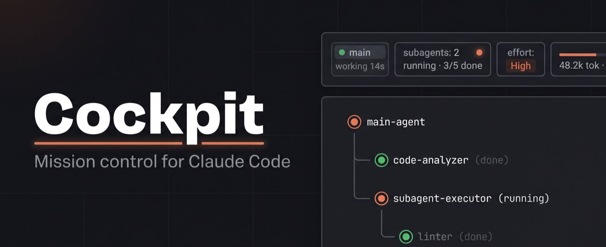
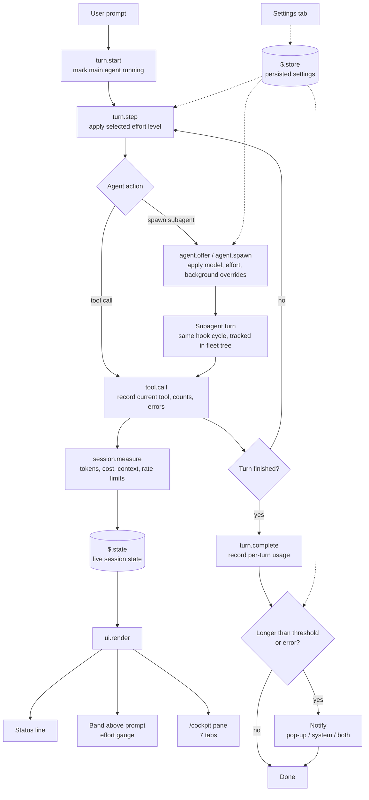
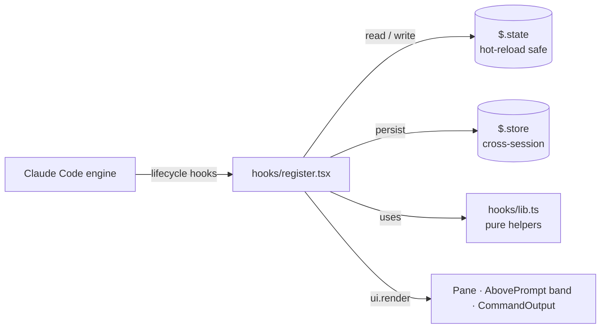

<div align="center">

# ✈ Cockpit

**Mission control for [Claude Code](https://code.claude.com).**
Live subagent fleet · token & cost telemetry · one-key effort switching · done-notifications.

[](CHANGELOG.md)
[](LICENSE)
[](https://code.claude.com)
[](tsconfig.json)
[](CONTRIBUTING.md)



</div>

---

## Contents

- [Why Cockpit](#why-cockpit)
- [Features](#features)
- [Installation](#installation)
- [Quick start](#quick-start)
- [Commands](#commands)
- [Configuration](#configuration)
- [Architecture](#architecture)
- [Development](#development)
- [Data & privacy](#data--privacy)
- [Limitations](#limitations)
- [Contributing](#contributing)
- [License](#license)

---

## Why Cockpit

Once Claude Code fans work out to subagents, the terminal stops telling you much. Which agent is running what? Where did the last 40k tokens go? Is the main turn finished, or still waiting on a subagent?

Cockpit answers those questions in real time, without leaving the session:

| Problem | Cockpit's answer |
| --- | --- |
| No visibility into parallel subagents | A live fleet tree showing the **exact tool each agent is running right now** |
| Token and cost spend is opaque | Per-turn token charts, cost KPIs, context-window and rate-limit bars |
| Changing effort means typing commands | A clickable gauge plus `⌥E` / `⌥⇧E` chords |
| You have to babysit long turns | Pop-up and/or system notifications when work finishes, with a minimum-duration threshold |
| Subagent behaviour is fixed | Global model, effort and background overrides, plus preset agent types |

---

## Features

### Status line

A single live line under the prompt:

```text
⠹ main working 14s · Bash npm test  │  ⑂ subagents 2 running · 3/5 done  │  ⚡ High  │  Σ 48.2k tok · $0.412 · ctx 31%
```

### Band above the prompt

Main-agent status, subagent counts, tokens, context usage and an interactive **effort gauge**:

```text
✈ Cockpit │ main ✓ done 42s │ ⑂ 0 running 3 done │ Σ 48.2k ctx 31%      ⚡ ◀ ▰▰▰▱▱ ▶ High  ⌥E up · ⌥⇧E down
```

Click a gauge segment to jump to that level, or step with ◀ / ▶.



### `/cockpit` — the seven-tab pane

With the pane focused, press `1`–`7` to switch tabs.

| # | Tab | What you get |
| --- | --- | --- |
| 1 | **Overview** | Cards for the main agent, subagents, tokens and context; effort control; live activity feed |
| 2 | **Agents** | Fleet tree (main + nested subagents) with each agent's current tool, swimlane timeline, per-subagent bar charts (tool calls, tokens, duration), and a detail drawer with each agent's tool mix |
| 3 | **Usage** | KPI tiles (input, output, cache, cost), context-window bar, plan rate-limit bars, tokens-per-turn column chart (main vs. subagents), split by model |
| 4 | **Git** | Branch, ahead/behind, changed files, and a coloured `git log --graph --all` — press `r` to refresh |
| 5 | **Logs** | Session log of prompts, tools, agents, turns, errors and alerts, with filter chips, paging, row inspection and **Export** to JSONL |
| 6 | **Terminal** | A zsh prompt in the session folder, independent of Claude's turn, with streaming output, Stop, Clear and quick commands |
| 7 | **Settings** | Notifications, effort, subagent customisation and display toggles |

### Notifications

Configured independently for the main agent and for subagents:

- **Mode:** Off · Pop-up · System · Both
- **Threshold:** only notify for turns longer than 10s, 30s, 1m or 2m
- **Errors:** choose whether failures trigger a notification

Where system notifications are unavailable, Cockpit falls back to the in-app pop-up.

### Subagent customisation

- **Model override** — run every subagent on Haiku, Sonnet or Opus
- **Effort override** — applied to every subagent request
- **Always background** — keep chatting while subagents work
- **Preset agent types** — `cockpit:reviewer`, `cockpit:tester`, `cockpit:scout` (Haiku), each toggleable

---

## Installation

### From the marketplace (recommended)

In a Claude Code **terminal** session:

```text
/plugin install cockpit --marketplace Shashwat-19/claude-cockpit
```

1. Answer `y` to add the marketplace.
2. Press Enter to install at **user** scope so Cockpit loads in every session, including the desktop app.

### From a local clone

Use this if you want to hack on Cockpit or pin a specific commit:

```bash
git clone https://github.com/Shashwat-19/claude-cockpit.git ~/claude-mods/cockpit
claude plugin marketplace add ~/claude-mods/cockpit
claude plugin install cockpit@cockpit --scope user
```

Claude Code reads the plugin directly from that folder. After editing, run `/reload-plugins`.

### Optional: effort keybindings (`⌥E` / `⌥⇧E`)

Merge [`examples/keybindings.json`](examples/keybindings.json) into `~/.claude/keybindings.json`.

On macOS, your terminal must send Option as Meta:

| Terminal | Setting |
| --- | --- |
| iTerm2 | Profiles → Keys → Left Option key = **Esc+** |
| Terminal.app | Settings → Profiles → Keyboard → **Use Option as Meta key** |

---

## Quick start

```text
/cockpit            # open the pane on Overview
/cockpit agents     # open straight to a tab
```

Then kick off any task that spawns subagents and watch the **Agents** tab fill in.

---

## Commands

| Command | Description |
| --- | --- |
| `/cockpit [tab]` | Open the pane, optionally on a specific tab |
| `/fleet` | Open the **Agents** tab |
| `/usage-chart` | Render a tokens-per-turn chart inline in the conversation |
| `/session-log` | Open the **Logs** tab |
| `/git-graph` | Open the **Git** tab |
| `/effort-up`, `/effort-down` | Change effort level — works everywhere, including the desktop app |

### Keyboard shortcuts

| Key | Context | Action |
| --- | --- | --- |
| `1`–`7` | Pane focused | Switch tab |
| `r` | Git tab | Refresh |
| `⌥E` / `⌥⇧E` | Terminal sessions | Effort up / down |

---

## Configuration

All settings live in the **Settings** tab and persist across sessions via `$.store`.

| Setting | Options |
| --- | --- |
| Main-agent notifications | Off · Pop-up · System · Both |
| Subagent notifications | Off · Pop-up · System · Both |
| Minimum turn length to notify | 10s · 30s · 1m · 2m |
| Notify on errors | On · Off |
| Effort | Model default, or a fixed level |
| Subagent model | Inherit · Haiku · Sonnet · Opus |
| Subagent effort | Inherit, or a fixed level |
| Always background subagents | On · Off |
| Preset agent types | Toggle `reviewer` / `tester` / `scout` individually |

---

## Architecture

Cockpit is a **Claude Code mod**: a hooks module the engine loads into a sandbox with **no DOM and no Node runtime**. All interaction with the engine goes through the `$` interface.



### Hook map

| Hook | Used for |
| --- | --- |
| `turn.start` / `turn.complete` | Main/subagent run status, per-turn token usage, notifications |
| `tool.call` | Live "current tool" per agent, tool counts and errors, timeline entries |
| `agent.spawn` / `agent.offer` | Subagent tracking; model / effort / background overrides; preset types |
| `turn.step` | Applies the selected effort level to each model request |
| `session.measure` | Context window, cost and plan rate limits |
| `ui.render` (`Pane`, `AbovePrompt`, `CommandOutput`) | The pane, the band and the inline usage chart |

### State model

- **Session state** is held by the host in `$.state` (typed in [`types/index.d.ts`](types/index.d.ts)), so a hot reload doesn't wipe it.
- **Settings** are saved with `$.store` and survive across sessions.
- **Pure logic** (formatting, text-chart rendering) is isolated in `hooks/lib.ts`, which keeps it unit-testable and free of `$` dependencies.

### Repository layout

```text
.
├── .claude-plugin/
│   ├── plugin.json          # plugin manifest
│   └── marketplace.json     # makes the repo installable via /plugin install
├── .github/ISSUE_TEMPLATE/  # bug report / feature request templates
├── assets/                  # banner and media
├── docs/                    # additional documentation
├── examples/
│   └── keybindings.json     # optional ⌥E / ⌥⇧E bindings
├── hooks/
│   ├── hooks.json           # declares the hooks module
│   ├── register.tsx         # every hook, view and action (all $-dependent code lives here)
│   └── lib.ts               # pure helpers: formatting, text charts
├── tests/
│   └── cockpit.test.ts      # run with `claude plugin test .`
├── types/
│   └── index.d.ts           # the $.state contract
├── CHANGELOG.md
├── CONTRIBUTING.md
├── LICENSE
└── tsconfig.json
```

---

## Development

```bash
claude plugin validate .   # validate the manifest and module exactly as the engine will
claude plugin test .       # run tests/*.test.ts against the engine (terminal + desktop surfaces)
claude --plugin-dir .      # start a session with this folder loaded; saving a file hot-reloads it
```

On first load, Claude Code writes its API types into `.claude-plugin/types/` (gitignored). After that:

```bash
npx tsc -p .               # type-check the mod
```

**Conventions**

- Anything that touches `$` goes in `hooks/register.tsx`; everything else belongs in `hooks/lib.ts`.
- New persistent state must be declared in `types/index.d.ts` first — that file is the contract.
- Run `validate`, `test` and `tsc` before opening a PR.

---

## Data & privacy

- Cockpit only observes sessions it is loaded into; it does **not** read past transcripts.
- Session logs stay local. **Export** writes to `~/.claude/cockpit-logs/<session>.jsonl` and nothing is sent anywhere else.
- Exported logs contain your prompts and tool calls — review them before sharing.
- The **Terminal** tab runs a real zsh shell in the session folder with your user's permissions. Treat it like any other terminal.

---

## Limitations

- `⌥E` / `⌥⇧E` work in **terminal** sessions only. In the desktop app, use the gauge or `/effort-up` / `/effort-down`.
- Effort is applied per request. If a model rejects a level, select **Model default** in Settings.
- Cockpit has no view into sessions it isn't loaded in.

---

## Contributing

Bug reports, feature requests and PRs are welcome. Use the [issue templates](.github/ISSUE_TEMPLATE) and read [CONTRIBUTING.md](CONTRIBUTING.md) before submitting. Release notes are tracked in [CHANGELOG.md](CHANGELOG.md).

---

## License

This project is distributed under the MIT License.  
For detailed licensing information, please refer to the [LICENSE](./LICENSE) file included in this repository.

## Contact  
## Shashwat

**Machine Learning Engineer | Scalable AI Systems**

🔹 **ML systems:** (CV, NLP) + data pipelines<br>
🔹 **End-to-end:** training → deployment<br>
🔹 **Backend & Cloud:** Python, Flask, Node.js, Docker, AWS<br>
🔹 **Projects:** Traffic AI, Video Summarizer, AI Assistants<br>

---

##  Open Source | Tech Innovation  
Building robust applications and leveraging cloud technologies for high-performance solutions.

---

### Find me here:  
[](https://github.com/Shashwat-19)  [](https://www.linkedin.com/in/shashwatk1956/)  [](mailto:shashwat1956@gmail.com)  [](https://hashnode.com/@Shashwat56)
[](https://www.hackerrank.com/profile/shashwat1956)

> Feel free to connect for tech collaborations, open-source contributions, or brainstorming innovative solutions!

